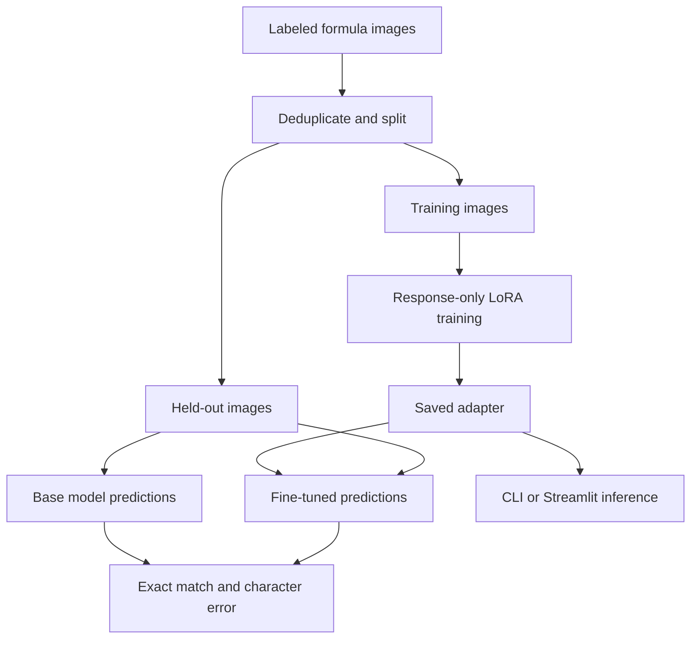

# Muse Glimmer LaTeX OCR

Fine-tune a local vision model to transcribe a formula image into its LaTeX source. The workflow measures a base checkpoint, trains LoRA adapters, evaluates the same held-out images, and saves the adapter for command-line or Streamlit inference. Strict exact match helps detect output-format and symbol errors that a visually similar formula can hide.

The CPU smoke run validates data conversion and evaluation with synthetic examples. It **does not** perform OCR inference, download model weights, or demonstrate trained accuracy. Actual Muse Glimmer training and inference require the separate GPU setup below and were not executed in the build environment.

## Code map

| Source file | Responsibility and connections |
| --- | --- |
| `ocr_data.py` | Validates labeled Pillow images, deduplicates pixel-identical images, rejects conflicting labels, splits held-out images, and creates image/text conversations for training. |
| `metrics.py` | Computes strict exact match, whitespace-ignored match, and aggregate character error rate for baseline and trained predictions. |
| `runtime.py` | Loads the local 4-bit model or adapter, validates the processor's ATEM boundary, and generates a direct transcription without sampling. Shared by training, CLI inference, and UI. |
| `train.py` | Orchestrates dataset loading, baseline generation, response-only LoRA training, adapter saving, and held-out evaluation. Writes predictions and metrics to `artifacts/evaluation.json`. |
| `training_config.py` | Builds compatible trainer arguments: omits the unsupported loss selector in TRL 0.22.2 and explicitly chooses NLL when a newer or patched configuration declares that field. |
| `infer.py` | Opens one image and calls the shared runtime using a base model or a saved local adapter. |
| `app.py` | Streamlit upload and LaTeX rendering UI, loading an existing local adapter once per session. |
| `demo.py` | Creates four synthetic images in memory and exercises deduplication, conversation preparation, and fixed-fixture metric calculations without loading a model. |
| `test_workflow.py` | Checks leakage prevention, conflicting labels, exact versus whitespace scoring, missing predictions, and ATEM prompt compatibility. |

`requirements.txt` covers the offline check. `requirements-training.txt` adds the model stack. `requirements-ui.txt` adds Streamlit. Generated data, checkpoints, model weights, and local secrets are excluded by `.gitignore`.



## Run the offline check

Python 3.11 or newer:

```bash
python -m venv .venv
# Linux / WSL / macOS:
source .venv/bin/activate
# Windows PowerShell alternative: .venv\Scripts\Activate.ps1
python -m pip install -r requirements.txt
python demo.py
python -m unittest -v
```

The demo reports three unique training examples and one held-out example. Its fixed candidate strings intentionally yield 50% strict exact match and 100% whitespace-ignored match; these are fixture checks, not model measurements. Whitespace-ignored matching is a formatting diagnostic and does not establish mathematical equivalence.

## Real local GPU workflow

Use a compatible NVIDIA CUDA environment, preferably Linux or WSL, with at least a 24 GiB GPU as an initial target. Capacity depends on library versions, image sizes, sequence length, and adapter targets; 24 GiB is not a guarantee. The 4-bit model download is roughly 21 GB and needs additional CPU RAM, cache space, checkpoint disk space, and activation headroom. A CPU-only installation cannot run this full workflow.

Install the CUDA-compatible PyTorch build and Unsloth prerequisites using the [official installation guide](https://unsloth.ai/docs/get-started/install), then install the project dependencies:

```bash
python -m pip install -r requirements-training.txt
python -m pip check
python train.py --samples 128 --eval-samples 8 --steps 30
```

The Transformers and TRL versions follow the inspected public vision notebook. If dependency resolution fails, use the upstream notebook's environment; do not force an incompatible stack with `--no-deps`. No API key is required by the application. If checkpoint access requires authentication, configure Hugging Face authentication in the local environment and keep tokens outside this project.

By default, the vision encoder remains frozen and language adapters train at rank 16. Add `--train-vision` to adapt both sides. The script loads the first 128 dataset records by default, deduplicates image pixels, shuffles with a fixed seed, and holds eight images out before building training conversations. Increase `--samples` and `--steps` for a larger experiment. The resulting small held-out set is a smoke evaluation, not a representative benchmark.

The collator excludes system, user, and image tokens from the loss. It checks that assistant tokens remain unmasked before training starts. TRL 0.22.2 uses the standard model loss path and has no `loss_type` constructor field; `training_config.py` omits it for that API and selects `"nll"` when a newer or patched configuration explicitly supports it. Explicit Unsloth inference/training transitions restore generation, checkpointing, padding, and cache settings between baseline evaluation and optimization. Strict exact match preserves LaTeX whitespace; it does not strip wrappers or commentary to improve a score.

```bash
python infer.py /path/to/formula.png
python infer.py /path/to/formula.png --model artifacts/adapter
```

For the UI, keep the adapter in `artifacts/adapter` or set `OCR_ADAPTER_DIR` to its directory:

```bash
python -m pip install -r requirements-ui.txt
streamlit run app.py --server.address 127.0.0.1
```

The UI loads an existing local adapter and does not start training. Model downloads happen during the initial GPU setup; after caching all dependencies and weights, local inference can run without an external inference service.

## Validation and limitations

- Verified locally: all Python source files compile; offline data/metric demo and nine regression checks pass, including strict old/new SFT configuration constructors.
- Verified against primary sources: model identifier, image/text conversation structure, direct-answer ATEM boundary, vision collator options, LoRA configuration, trainer settings, and adapter save/load calls.
- Not run: model downloads, CUDA inference, LoRA optimization, adapter reload, or Streamlit model execution. No accuracy gain is claimed.
- LaTeX OCR is sensitive to single-symbol errors. Inspect held-out predictions and test on your own documents before using transcriptions.

## Upstream references

- [Unsloth source](https://github.com/unslothai/unsloth)
- [TRL 0.22.2 trainer configuration](https://github.com/huggingface/trl/blob/v0.22.2/trl/trainer/sft_config.py)
- [Verified vision notebook](https://github.com/unslothai/notebooks/blob/678bfaa597605d1efb6e3f23e76f5fe9216ddcc4/nb/Muse_Glimmer_%2830B%29-Vision.ipynb)
- [Muse Glimmer training guide](https://unsloth.ai/docs/models/muse-glimmer/train)
- [Base model card](https://huggingface.co/meta-models/Muse-Glimmer-30B)
- [4-bit checkpoint](https://huggingface.co/unsloth/Muse-Glimmer-30B-unsloth-bnb-4bit)
- [LaTeX image dataset](https://huggingface.co/datasets/unsloth/LaTeX_OCR)

These are original scripts using the upstream libraries' public interfaces; upstream library, dataset, and model licenses still govern those components.
